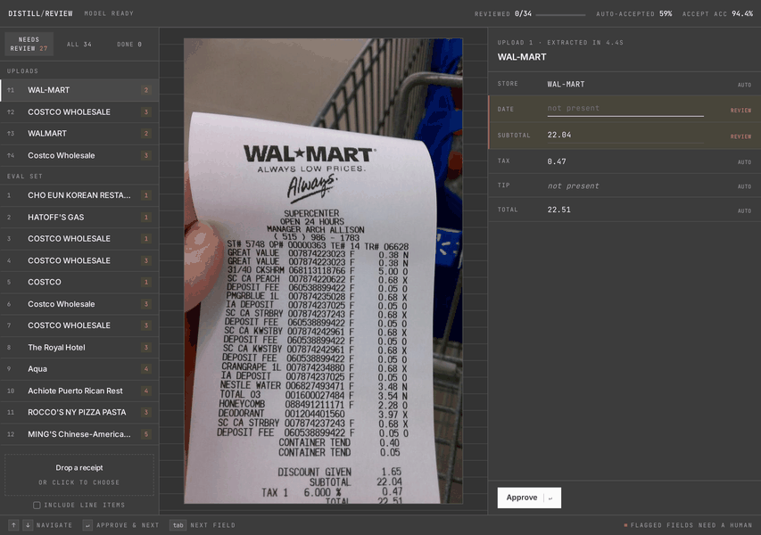
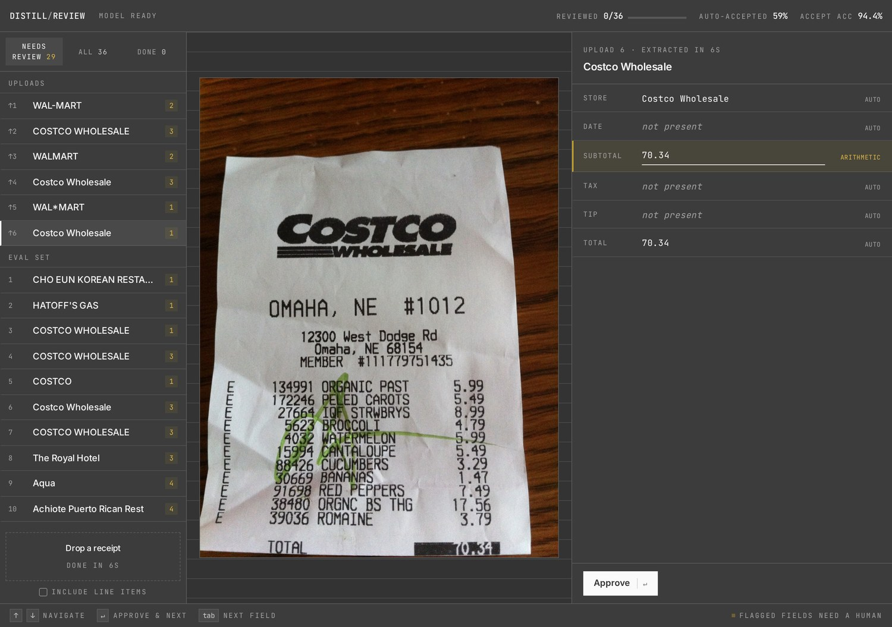
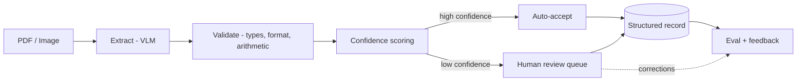

# Distill

> Turn messy invoices and receipts into clean, trusted, structured data, with per-field confidence and human-in-the-loop review. Runs locally.

**Status:** Working end to end. Extraction, confidence gating, validation, and the human review queue are built and measured. The model alone is ~80% accurate per field; the system delivers **~97%** because it routes the fields it does not trust to a human, and it does that for 59% of fields automatically. Runs locally on a single consumer GPU.

## Demo



Drop a receipt; about four seconds later the fields come back, each with a confidence score. Fields the model agrees with itself on *and* that survive validation are auto-accepted and shown quietly. Everything else is highlighted, editable, and waiting for a human. Corrections persist and feed back into evaluation. Keyboard-driven, so a reviewer never leaves the home row.

### Why this is not an OCR wrapper



This Costco receipt goes straight from line items to `TOTAL 70.34`. There is no subtotal line on it at all. The model reports a subtotal anyway, copying the total, and nothing about `70.34` looks wrong in isolation: it is a plausible number, correctly formatted, in the right place. A bare LLM hands it to your accounting system.

Distill flags it, because a subtotal equal to the total with no tax printed is arithmetically incoherent. The field goes to a human instead of into the books. That is the entire thesis: the model does not have to be right, it has to know when it might be wrong.

```bash
uvicorn review.app:app --port 8990    # then drop a receipt at localhost:8990
```

## Overview

Distill is a document-to-structured-data engine. Hand it a scanned or PDF invoice or receipt and it returns clean, typed data (vendor, date, totals, tax, line items) as JSON, with a confidence score on every field and a review step for the fields it is not sure about. It is designed to run entirely on local hardware, so documents never leave the machine.

Unlike a raw OCR script or a single LLM call, Distill knows what it does not know. High-confidence fields are auto-accepted; low-confidence fields are routed to a human. Knowing which is which is what turns document extraction from a fragile demo into something a business can actually run.

## The problem

Businesses receive large volumes of semi-structured documents where the important information is trapped in inconsistent layouts. Today humans retype that data into accounting and ERP systems. It is slow, expensive, and error-prone. The naive automations fail badly: raw OCR loses structure, and a bare LLM is sometimes confidently wrong with no signal about which extractions to trust. Distill solves the trust problem, not just the extraction problem.

## Key features

- **Structured, typed output.** Every document maps to a validated schema (Pydantic), not free text.
- **Validation built in.** Type checks, format rules, and arithmetic checks (do line items sum to the total?).
- **Confidence that predicts error.** Per-field scores from self-consistency sampling plus validation. Fields the system trusts are 94.4% accurate; fields it flags are 54.1%, a 40-point separation that makes auto-accept safe.
- **Human-in-the-loop.** A review queue surfaces only the uncertain fields, and corrections are persisted.
- **Rigorous evaluation.** Field-level precision, recall, and F1 against gold labels, plus auto-accept coverage and slice accuracy. Every confident-but-wrong case was audited against the source image.
- **Tested.** 111 tests, most written from real failures found in error analysis. CI also re-scores frozen predictions from real runs, so a change that silently moves a published number fails the build.
- **Local-first.** Private by default and zero per-document cost, so large eval loops are free to run.

## How it works



1. **Ingest** the document image or PDF.
2. **Extract** fields with a vision-language model.
3. **Validate** with type, format, and arithmetic rules.
4. **Score** each field: sample the extraction k times, take the majority, and set confidence to the agreement rate. Fields that fail validation get their confidence capped.
5. **Route** high-confidence fields to auto-accept and low-confidence fields to human review.
6. **Measure** with an eval harness and feed corrections back in.

## Use cases

**Direct (invoices and receipts):**
- Accounts payable automation into accounting/ERP systems (QuickBooks, NetSuite, SAP).
- Expense management and reimbursement (merchant, date, amount, tax, category).
- Bookkeeping and tax preparation.
- Spend and procurement analysis from line items.

**Same engine, different schema:**
- Contract intelligence (parties, dates, renewal and liability terms).
- Resume parsing into structured candidate profiles.
- Forms processing (insurance claims, loan applications, intake forms).
- Logistics documents (bills of lading, packing slips, customs forms).

Because the pipeline is schema-driven, targeting a new document type is a config-and-fine-tune job, not a rewrite.

## Tech stack

**Built:**
- **Language:** Python 3.12
- **Compute:** PyTorch + CUDA, local on an NVIDIA RTX 4070 (12GB), developed under WSL2
- **Models:** Qwen2.5-VL-3B zero-shot (production path); a fine-tuned Donut, 40x faster but not yet as accurate
- **Data:** WildReceipt (North American English receipts, MMOCR format), filtered to USD
- **Schema and validation:** Pydantic, plus arithmetic and format checks
- **Evaluation:** custom harness (field P/R/F1, auto-accept curve, calibration table)
- **Service:** FastAPI backend, single-file review UI (no build step)
- **CI:** GitHub Actions — unit tests plus a metrics regression gate that re-scores frozen predictions on every push
- **Tracing:** per-document JSONL span log with latency percentiles, throughput, and the hosted-API counterfactual

**Planned:** per-document cost and latency tracing, Docker packaging, deployment.

## Project status and roadmap

- [x] **Phase 0, vertical slice:** zero-shot extraction on CORD receipts, field-level F1 scoring, error-analysis-driven prompt and parser fixes. Overall F1 0.79 to 0.88 (n=100 test set, no fine-tuning). Per field: total 0.95, subtotal 0.89, tax 0.72.
- [x] **Phase 1, core:** full schema, structured-output extraction, validation, confidence scoring, baseline eval.
  - [x] 5-field schema + zero-shot baseline (F1 0.795, n=100 USD test set)
  - [x] Self-consistency confidence (k=5) + arithmetic and date-shape validation: confident slice 87.1% → 94.4% across three eval-driven iterations
  - [x] Line-item extraction + tip field; item sums exculpate a confirmed subtotal (built and unit-tested; measured on a small sample only)
- [ ] **Phase 2, differentiators:** human review queue, confidence calibration, tracing and cost, CI eval gate.
  - [x] Human review queue (FastAPI + web UI, corrections persisted)
  - [x] CI running the test suite on every push
  - [x] Calibration measured (ECE 0.115, MCE 0.275) with a reliability table and a recalibration fit
  - [x] CI gate on metric regressions (re-scores frozen predictions, fails the build if published numbers move)
  - [x] Per-document latency and cost tracing (JSONL span log, `/api/traces`, percentiles and throughput)
- [ ] **Phase 3, polish:** deployment, results writeup.
  - [x] Fine-tuned small model trained and evaluated (0.583 F1 at 0.16 s/doc; see the fine-tuning section below)
  - [ ] Train it to parity with the zero-shot baseline, then deploy it CPU-only

**Definition of done:** typed output, per-field confidence that predicts error, human review queue, full eval harness (field precision/recall/F1 + calibration + auto-accept rate), LLMOps (tracing, cost/latency, CI gate on regressions), and a deployed demo with a metrics-backed README. **Deployment is the only item outstanding.**

## Results

Three numbers, because "accuracy" means three different things here. Reproduce them all with `python summarize_accuracy.py`.

| Stage | Accuracy | Notes |
| --- | --- | --- |
| **1. Raw extraction** | **0.804** field F1 | Zero-shot, no gating. n=100 receipts, 5 fields (tax 0.85, store 0.82, date 0.80, total 0.80, subtotal 0.75) |
| **2. Auto-accepted slice** | **94.4%** measured, ~96.6% audited | Covers 59.3% of fields. Flagged fields are only 54.1% accurate, a **+40 point separation** |
| **3. End-to-end delivered** | **96.7%** | Auto-accept + human corrects the flagged 40.7%. The number that matters commercially |

| Other metric | Target | Current |
| --- | --- | --- |
| Confidence calibration (ECE) | < 0.05 | **0.115** — the signal separates well but is not well scaled; see below |
| Latency per document | < 3s | p50 **4.9s**, p95 12.4s at k=3 (traced); Donut 0.16s on GPU, ~5.0s on CPU |
| Cost per document | $0.00 | $0.00 local — the same volume on a hosted vision API would bill ~$0.004/doc |

**Honest caveats.** The confidence numbers come from n=30 receipts (150 field decisions), so read them as ±5 points; the +40 point separation is far too wide for sample noise to threaten, but the point estimate will move. All figures are **field-level**, not document-level ("every field on this receipt is correct" is a much harder bar and would be substantially lower). The end-to-end number assumes the human reviewer is always right, so treat it as a ceiling. WildReceipt's own labels contain real errors, which caps measurable accuracy below what the model actually achieves: of the 5 confident-but-wrong fields in the last run, 2 were cases where the model was right and the dataset was wrong.

### Fine-tuning experiment: a speed win, not an accuracy win

The zero-shot VLM is 3B parameters and needs a GPU. A fine-tuned [Donut](https://github.com/clovaai/donut) is ~200M and runs on CPU, so the obvious move was to train one and get accuracy *and* deployability together. Half of that worked.

| | zero-shot Qwen2.5-VL-3B | fine-tuned Donut (45 epochs) |
| --- | --- | --- |
| Overall field F1 | **0.804** | 0.583 |
| store / date | 0.82 / 0.80 | 0.74 / 0.79 |
| subtotal / tax / total | 0.74 / 0.84 / 0.78 | 0.61 / 0.09 / 0.45 |
| Latency | 6.5 s/doc (GPU) | **0.16 s/doc** on GPU, **~5.0 s/doc on CPU** |
| Params | 3B, ~8GB VRAM | 200M, runs with no GPU at all |

**The honest read: it is undertrained, not incapable.** Accuracy was still climbing when the run ended (overall 0.497 at 20 epochs to 0.583 at 45; `total_price` went 0.056 to 0.453 as it finally learned to emit more than one price field per receipt) and the loss was still falling at 0.42. The untried lever is the LR warmup and cosine schedule the Donut paper uses, which this run skipped. Reaching 0.795 plausibly needs a few hundred more epochs, which is hours, not days, on a consumer GPU.

Three bugs surfaced along the way, none of which the metrics alone would have revealed. Each was caught by printing the raw generated sequence instead of trusting an F1 of 0.000:

1. **Label misalignment.** Targets begin with `<s_receipt>` and `decoder_start_token_id` was that same token, so passing only `labels` let the model derive decoder inputs by shifting right and prepending a *second* one. It was trained to predict `<s_receipt>` from `<s_receipt>` instead of the first real field. The raw output gave it away: correct content (`CHOEUN`, `13.99`) in scrambled structure.
2. **Token imbalance.** With line items in the target, `<s_description>` outnumbered `<s_store_name>` 4,476 to 731, so the model learned the frequent tokens and never emitted a header field at all. Header-only targets fixed it, and match the scope the zero-shot baseline is scored on.
3. **Brittle parsing.** The model emits `<s_subtotal_price> 55.96</s_total_price>` — right field, right value, wrong closing tag. A strict `<s_X>...</s_X>` regex discarded a correct extraction over a formatting artifact.

Reproduce with `python -m finetune.prepare_data --no-items`, `python -m finetune.train_donut --epochs 20`, `python -m finetune.eval_donut --n 100`. Evaluation runs through the same `distill.score` as the baseline, so the two numbers are measured with one ruler.


### Is the confidence *calibrated*, not just separating?

Separation says the signal ranks correctly; calibration asks whether the number means what it says. Run `python run_calibration.py`:

| stated | n | observed accuracy | gap |
| --- | --- | --- | --- |
| 1.00 | 89 | 0.944 | -0.056 |
| 0.80 | 6 | 0.667 | -0.133 |
| 0.60 | 9 | 0.444 | -0.156 |
| 0.50 | 34 | 0.706 | **+0.206** |
| 0.40 | 8 | 0.125 | -0.275 |
| 0.20 | 4 | 0.000 | -0.200 |

**ECE 0.115, MCE 0.275** — well short of the < 0.05 target, and the shape is informative:

- Fields capped at **0.5 by validation are actually 70.6% correct**. That is the over-flagging problem with a number on it: arithmetic checks route work to a human that a human usually did not need to see. Recovering that bin is where the auto-accept coverage gap (59%) mostly lives.
- Every sampling-derived level is **overconfident**. A k-sample agreement rate is a useful ordering, but it is not a probability, and treating it as one would misprice any threshold policy built on top.

Refitting each level to its observed accuracy drops in-sample ECE to 0.004, but that is a lookup fitted on the same 150 decisions it is scored against — a floor, not a generalisation estimate. Applying it to the product honestly needs a second labelled run, so the fit ships as a reported measurement rather than a silent change to the pipeline.


## Getting started

**Prerequisites:** WSL2 with CUDA, an NVIDIA GPU with 12GB or more VRAM, Python 3.11.

```bash
bash setup_wsl.sh                 # venv + CUDA torch + deps, verifies the GPU

# data: WildReceipt (MMOCR release), extracted to data/wildreceipt/
mkdir -p data && cd data && wget https://download.openmmlab.com/mmocr/data/wildreceipt.tar && tar -xf wildreceipt.tar && cd ..
```

```bash
python run_phase0.py --n 100                      # extraction baseline, prints field F1
python run_confidence.py --n 30 --k 5             # confidence gating (add --no-items to run ~4x cheaper)
python summarize_accuracy.py                      # all three headline numbers
python run_calibration.py                         # reliability table + ECE/MCE
curl localhost:8990/api/traces                    # latency percentiles + cost
uvicorn review.app:app --port 8990                # review queue at localhost:8990
pytest tests/ -q                                  # 111 tests
```

Analysis helpers: `analyze_confidence.py` (calibration table + auto-accept curve), `list_confident_wrong.py` (the dangerous cases: confident and wrong), `analyze_errors.py`, `rescore.py` (re-score saved predictions after a scorer change, no GPU needed).

## License

MIT, see [LICENSE](LICENSE).

The code is MIT. The WildReceipt dataset is not redistributed here and carries its own terms from the [MMOCR project](https://github.com/open-mmlab/mmocr); download it separately as shown above.

---
