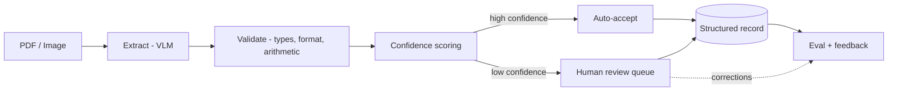

# Distill

> Turn messy invoices and receipts into clean, trusted, structured data, with per-field confidence and human-in-the-loop review. Runs locally.

**Status:** Working end to end. Extraction, confidence gating, validation, and the human review queue are built and measured. The model alone is ~80% accurate per field; the system delivers **~97%** because it routes the fields it does not trust to a human, and it does that for 59% of fields automatically. Runs locally on a single consumer GPU.

## Demo


The review queue. Fields the model is confident about are auto-accepted and shown quietly with their confidence; fields it distrusts are highlighted and editable. Corrections are persisted and feed back into evaluation. Keyboard-driven, so a reviewer never leaves the home row.

```bash
uvicorn review.app:app --port 8990
```

## Overview

Distill is a document-to-structured-data engine. Hand it a scanned or PDF invoice or receipt and it returns clean, typed data (vendor, date, totals, tax, line items) as JSON, with a confidence score on every field and a review step for the fields it is not sure about. It is designed to run entirely on local hardware, so documents never leave the machine.

Unlike a raw OCR script or a single LLM call, Distill knows what it does not know. High-confidence fields are auto-accepted; low-confidence fields are routed to a human. Knowing which is which is what turns document extraction from a fragile demo into something a business can actually run.

## The problem

Businesses receive large volumes of semi-structured documents where the important information is trapped in inconsistent layouts. Today humans retype that data into accounting and ERP systems. It is slow, expensive, and error-prone. The naive automations fail badly: raw OCR loses structure, and a bare LLM is sometimes confidently wrong with no signal about which extractions to trust. Distill solves the trust problem, not just the extraction problem.

## Key features

- **Structured, typed output.** Every document maps to a validated schema (Pydantic), not free text.
- **Validation built in.** Type checks, format rules, and arithmetic checks (do line items sum to the total?).
- **Confidence that predicts error.** Per-field scores from self-consistency sampling plus validation. Fields the system trusts are 94.4% accurate; fields it flags are 54.1%, a 40-point separation that makes auto-accept safe.
- **Human-in-the-loop.** A review queue surfaces only the uncertain fields, and corrections are persisted.
- **Rigorous evaluation.** Field-level precision, recall, and F1 against gold labels, plus auto-accept coverage and slice accuracy. Every confident-but-wrong case was audited against the source image.
- **Tested.** 86 unit tests, most written from real failures found in error analysis, run in CI on every push.
- **Local-first.** Private by default and zero per-document cost, so large eval loops are free to run.

## How it works



1. **Ingest** the document image or PDF.
2. **Extract** fields with a vision-language model.
3. **Validate** with type, format, and arithmetic rules.
4. **Score** each field: sample the extraction k times, take the majority, and set confidence to the agreement rate. Fields that fail validation get their confidence capped.
5. **Route** high-confidence fields to auto-accept and low-confidence fields to human review.
6. **Measure** with an eval harness and feed corrections back in.

## Use cases

**Direct (invoices and receipts):**
- Accounts payable automation into accounting/ERP systems (QuickBooks, NetSuite, SAP).
- Expense management and reimbursement (merchant, date, amount, tax, category).
- Bookkeeping and tax preparation.
- Spend and procurement analysis from line items.

**Same engine, different schema:**
- Contract intelligence (parties, dates, renewal and liability terms).
- Resume parsing into structured candidate profiles.
- Forms processing (insurance claims, loan applications, intake forms).
- Logistics documents (bills of lading, packing slips, customs forms).

Because the pipeline is schema-driven, targeting a new document type is a config-and-fine-tune job, not a rewrite.

## Tech stack

**Built:**
- **Language:** Python 3.12
- **Compute:** PyTorch + CUDA, local on an NVIDIA RTX 4070 (12GB), developed under WSL2
- **Model:** Qwen2.5-VL-3B (zero-shot, no fine-tuning yet)
- **Data:** WildReceipt (North American English receipts, MMOCR format), filtered to USD
- **Schema and validation:** Pydantic, plus arithmetic and format checks
- **Evaluation:** custom harness (field P/R/F1, auto-accept curve, calibration table)
- **Service:** FastAPI backend, single-file review UI (no build step)
- **CI:** GitHub Actions running the test suite on every push

**Planned:** Donut fine-tune (scaffold in `finetune/`, untested), per-document cost and latency tracing, CI gate on accuracy regressions, Docker packaging, deployment.

## Project status and roadmap

- [x] **Phase 0, vertical slice:** zero-shot extraction on CORD receipts, field-level F1 scoring, error-analysis-driven prompt and parser fixes. Overall F1 0.79 to 0.88 (n=100 test set, no fine-tuning). Per field: total 0.95, subtotal 0.89, tax 0.72.
- [x] **Phase 1, core:** full schema, structured-output extraction, validation, confidence scoring, baseline eval.
  - [x] 5-field schema + zero-shot baseline (F1 0.795, n=100 USD test set)
  - [x] Self-consistency confidence (k=5) + arithmetic and date-shape validation: confident slice 87.1% → 94.4% across three eval-driven iterations
  - [x] Line-item extraction + tip field; item sums exculpate a confirmed subtotal (built and unit-tested; measured on a small sample only)
- [ ] **Phase 2, differentiators:** human review queue, confidence calibration, tracing and cost, CI eval gate.
  - [x] Human review queue (FastAPI + web UI, corrections persisted)
  - [x] CI running the test suite on every push
  - [ ] Calibration (ECE), per-document cost/latency tracing, CI gate on accuracy regressions
- [ ] **Phase 3, polish:** deployment, fine-tuned small model, results writeup.

**Definition of done:** typed output, per-field confidence that predicts error, human review queue, full eval harness (field precision/recall/F1 + calibration + auto-accept rate), LLMOps (tracing, cost/latency, CI gate on regressions), and a deployed demo with a metrics-backed README. Everything but calibration, tracing, and deployment is in place.

## Results

Three numbers, because "accuracy" means three different things here. Reproduce them all with `python summarize_accuracy.py`.

| Stage | Accuracy | Notes |
| --- | --- | --- |
| **1. Raw extraction** | **0.795** field F1 | Zero-shot, no gating. n=100 receipts, 5 fields (tax 0.84, store 0.82, date 0.80, total 0.78, subtotal 0.74) |
| **2. Auto-accepted slice** | **94.4%** measured, ~96.6% audited | Covers 59.3% of fields. Flagged fields are only 54.1% accurate, a **+40 point separation** |
| **3. End-to-end delivered** | **96.7%** | Auto-accept + human corrects the flagged 40.7%. The number that matters commercially |

| Other metric | Target | Current |
| --- | --- | --- |
| Confidence calibration (ECE) | < 0.05 | not yet measured |
| Latency per document | < 3s | 6.5s single pass; 20-50s at k=5 sampling |
| Cost per document | $0.00 | $0.00 (local) |

**Honest caveats.** The confidence numbers come from n=30 receipts (150 field decisions), so read them as ±5 points; the +40 point separation is far too wide for sample noise to threaten, but the point estimate will move. All figures are **field-level**, not document-level ("every field on this receipt is correct" is a much harder bar and would be substantially lower). The end-to-end number assumes the human reviewer is always right, so treat it as a ceiling. WildReceipt's own labels contain real errors, which caps measurable accuracy below what the model actually achieves: of the 5 confident-but-wrong fields in the last run, 2 were cases where the model was right and the dataset was wrong.

## Getting started

**Prerequisites:** WSL2 with CUDA, an NVIDIA GPU with 12GB or more VRAM, Python 3.11.

```bash
bash setup_wsl.sh                 # venv + CUDA torch + deps, verifies the GPU

# data: WildReceipt (MMOCR release), extracted to data/wildreceipt/
mkdir -p data && cd data && wget https://download.openmmlab.com/mmocr/data/wildreceipt.tar && tar -xf wildreceipt.tar && cd ..
```

```bash
python run_phase0.py --n 100                      # extraction baseline, prints field F1
python run_confidence.py --n 30 --k 5             # confidence gating (add --no-items to run ~4x cheaper)
python summarize_accuracy.py                      # all three headline numbers
uvicorn review.app:app --port 8990                # review queue at localhost:8990
pytest tests/ -q                                  # 86 tests
```

Analysis helpers: `analyze_confidence.py` (calibration table + auto-accept curve), `list_confident_wrong.py` (the dangerous cases: confident and wrong), `analyze_errors.py`, `rescore.py` (re-score saved predictions after a scorer change, no GPU needed).

## License

MIT (planned).

---
