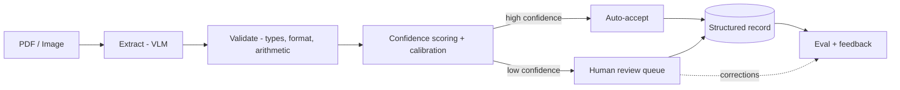

# Distill

> Turn messy invoices and receipts into clean, trusted, structured data, with calibrated confidence and human-in-the-loop review. Runs locally.

**Status:** Confidence scoring works. Fields where all k=5 samples agree and validation passes are 94.4% accurate (measured) / ~96.6% (after auditing every disagreement against the source image; the gap is dataset label noise) at 59% auto-accept coverage, vs 54% accuracy on flagged fields. Next: line-item extraction to reclaim coverage, then the review queue. Local-first, single consumer GPU.

## Overview

Distill is a document-to-structured-data engine. Hand it a scanned or PDF invoice or receipt and it returns clean, typed data (vendor, date, totals, tax, line items) as JSON, with a confidence score on every field and a review step for the fields it is not sure about. It is designed to run entirely on local hardware, so documents never leave the machine.

Unlike a raw OCR script or a single LLM call, Distill knows what it does not know. High-confidence fields are auto-accepted; low-confidence fields are routed to a human. That calibrated confidence is what turns document extraction from a fragile demo into something a business can actually run.

## The problem

Businesses receive large volumes of semi-structured documents where the important information is trapped in inconsistent layouts. Today humans retype that data into accounting and ERP systems. It is slow, expensive, and error-prone. The naive automations fail badly: raw OCR loses structure, and a bare LLM is sometimes confidently wrong with no signal about which extractions to trust. Distill solves the trust problem, not just the extraction problem.

## Key features

- **Structured, typed output.** Every document maps to a validated schema (Pydantic), not free text.
- **Validation built in.** Type checks, format rules, and arithmetic checks (do line items sum to the total?).
- **Calibrated confidence.** Per-field confidence scores tuned so a low score genuinely predicts an error.
- **Human-in-the-loop.** A review queue surfaces only the uncertain fields, and corrections feed back into evaluation.
- **Rigorous evaluation.** Field-level precision, recall, and F1 against gold labels, plus calibration and auto-accept-rate metrics.
- **LLMOps.** Tracing, cost and latency per document, and a CI gate that blocks accuracy regressions.
- **Local-first.** Private by default and zero per-document cost, so large eval loops are free to run.

## How it works

1. **Ingest** the document image or PDF.
2. **Extract** fields with a vision-language model.
3. **Validate** with type, format, and arithmetic rules.
4. **Score** each field with a calibrated confidence.
5. **Route** high-confidence fields to auto-accept and low-confidence fields to human review.
6. **Measure** with an eval harness and feed corrections back in.

## Use cases

**Direct (invoices and receipts):**
- Accounts payable automation into accounting/ERP systems (QuickBooks, NetSuite, SAP).
- Expense management and reimbursement (merchant, date, amount, tax, category).
- Bookkeeping and tax preparation.
- Spend and procurement analysis from line items.

**Same engine, different schema:**
- Contract intelligence (parties, dates, renewal and liability terms).
- Resume parsing into structured candidate profiles.
- Forms processing (insurance claims, loan applications, intake forms).
- Logistics documents (bills of lading, packing slips, customs forms).

Because the pipeline is schema-driven, targeting a new document type is a config-and-fine-tune job, not a rewrite.

## Tech stack

- **Language:** Python 3.11
- **Compute:** PyTorch + CUDA, local on an NVIDIA RTX 4070 (12GB), developed under WSL2
- **Models:** Qwen2.5-VL-3B for zero-shot extraction; Donut / LayoutLMv3 fine-tuned with LoRA for accuracy
- **Data:** WildReceipt (North American English receipts, MMOCR format), filtered to USD
- **Schema and validation:** Pydantic
- **Evaluation:** custom harness, scikit-learn metrics, confidence calibration
- **Service:** FastAPI backend, Streamlit review UI
- **Ops:** structured logging with per-document cost and latency tracking, GitHub Actions eval gate
- **Packaging:** Docker (optional, for the demo)

## Project status and roadmap

- [x] **Phase 0, vertical slice:** zero-shot extraction on CORD receipts, field-level F1 scoring, error-analysis-driven prompt and parser fixes. Overall F1 0.79 to 0.88 (n=100 test set, no fine-tuning). Per field: total 0.95, subtotal 0.89, tax 0.72.
- [ ] **Phase 1, core:** full schema, robust structured-output extraction, validation, confidence scoring, baseline eval.
  - [x] 5-field schema + zero-shot baseline (F1 0.795, n=100 USD test set)
  - [x] Self-consistency confidence (k=5) + arithmetic and date-shape validation: confident slice 87.1% → 94.4% across three eval-driven iterations
  - [ ] Line-item extraction (richer arithmetic: items must sum to subtotal; catches consistent digit misreads and reclaims over-flagged coverage)
- [ ] **Phase 2, differentiators:** confidence calibration, human review queue, tracing and cost, CI eval gate.
- [ ] **Phase 3, polish:** frontend and demo, deployment, results writeup.

**Definition of done:** typed output, calibrated per-field confidence, human review queue, full eval harness (field precision/recall/F1 + calibration + auto-accept rate), LLMOps (tracing, cost/latency, CI gate), and a deployed demo with a metrics-backed README.

## Results (targets, filled in as built)

| Metric | Target | Current |
| --- | --- | --- |
| Field-level F1 (key fields) | > 0.90 | 0.795 on WildReceipt/USD, 5 fields (store 0.82, date 0.80, subtotal 0.74, tax 0.84, total 0.78) |
| Auto-accept slice accuracy (conf = 1.0) | > 95% | 94.4% measured, ~96.6% image-audited, at 59.3% coverage |
| Auto-accept rate at 99% field accuracy | > 60% | in progress (coverage reclaim via line items) |
| Confidence calibration (ECE) | < 0.05 | TBD (Phase 2) |
| Median latency per document | < 3s | 6.5s (unoptimized) |
| Cost per document | $0.00 (local) | $0.00 (local) |

## Getting started

**Prerequisites:** WSL2 with CUDA, an NVIDIA GPU with 12GB or more VRAM, Python 3.11.

Setup and run instructions land with Phase 0. The first milestone is a single command that extracts fields from a batch of receipts and prints the baseline F1.

## License

MIT (planned).

---
